<div align="center">

# YMPME

### mini 物理运动引擎 · 让机构动起来，让反馈看得见

**C99 · 模块裁剪 · 刚体与关节 · 接触力反馈 · 独立于渲染**

[看演示](#demo-实录) · [快速开始](#快速开始) · [模块与裁剪](#模块与裁剪) · [使用 SDK](#使用-sdk) · [接口文档](API.md)

</div>

当前源码版本 **0.4.0** · [版本记录](CHANGELOG.md) · [稳定性与构建验证](tests/README.md) · [下载发布包](releases/README.md)

YMPME 面向小游戏、机构实验与控制仿真：从差速小车、齿轮和绳索，到刚体履带、软指抓取、飞行与全身触觉，也提供独立可裁剪的结构有限元静力分析。物理由 PME 计算，窗口与显示交给 **YMGRE**，需要骨骼动画的应用再接入 **YMSKE**。核心库可独立运行，按 PC / MCU 的使用方式设计。

[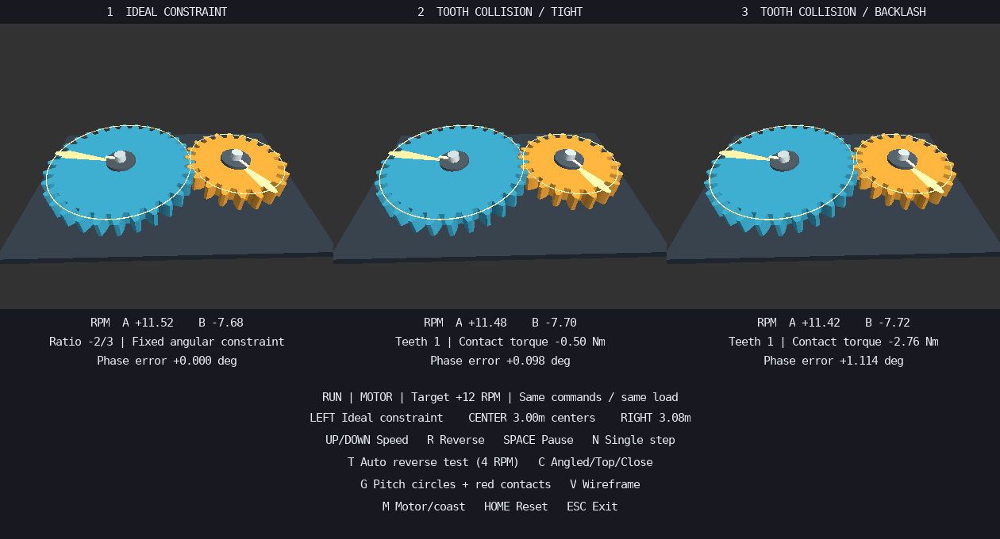](docs/screenshots/gear_mesh.png)

<p align="center"><b>同一组输入，三种啮合结果。</b> 理想传动比、逐齿接触力矩、齿隙回差，在一个窗口里对照。<br><a href="project_Demo/gear_mesh/README.md">齿轮演示与操作说明 →</a></p>

## Demo 实录

以下均为现有可执行程序经 GRE 渲染的实际完整帧，保留读数与操作界面。点击图片查看原图；[截图记录](docs/screenshots/README.md)包含复现参数。截图展示对应构建的运行状态，不作为性能基准。

[机械与绳索](#机械与绳索) · [车辆与飞行](#车辆与飞行) · [抓取与感知](#抓取与感知) · [有限元静力分析](#有限元静力分析) · [更多入门演示](#更多入门演示)

### 机械与绳索

**皮带、滑轮组与绳端摆动**

[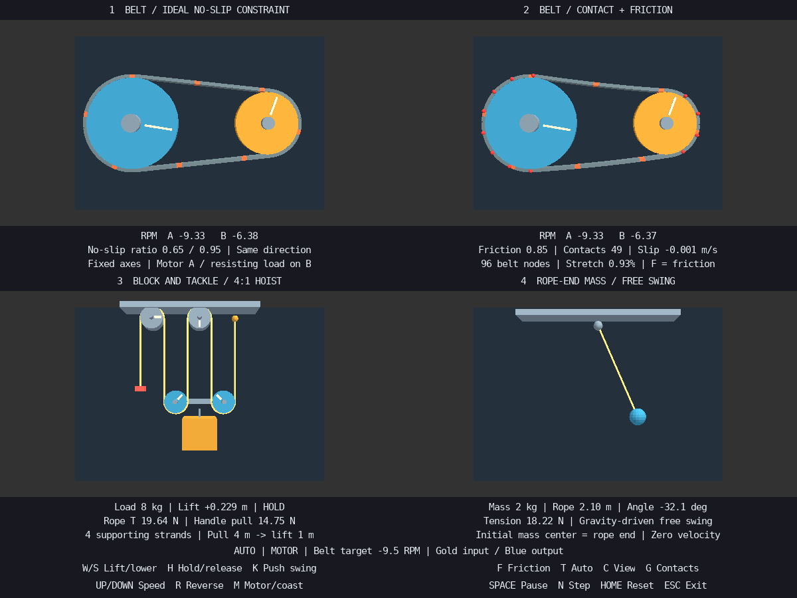](docs/screenshots/mechanisms.png)

**一个窗口，四套机构。** 左右皮带对照理想约束与接触摩擦；下方四股绳支承 8 kg 重物，旁边的 2 kg 绳端挂物自由摆动。可反转、提升、释放和关闭摩擦；滑轮使用理想绳长约束。[进入 demo →](project_Demo/mechanisms/README.md)

**绳索下垂、U 型挂物与移动锚点**

[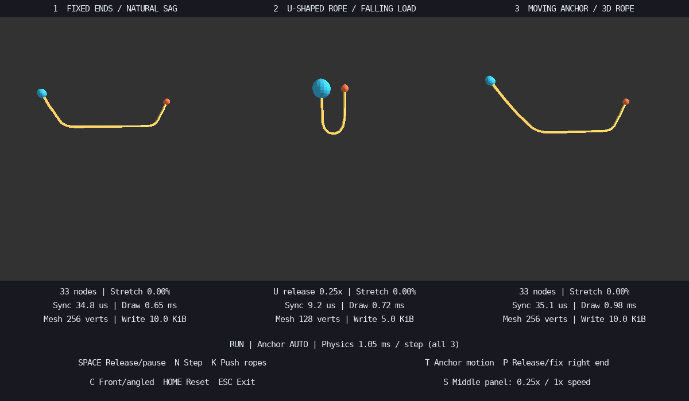](docs/screenshots/rope_lab.png)

**同一个绳索模型，三种边界条件。** 两端固定自然下垂，U 型绳随端点重物释放逐渐拉直，右侧锚点在三维空间运动。支持慢放、推动和释放端点；当前不含绳身碰撞与缠绕。[进入 demo →](project_Demo/rope_lab/README.md)

| 双轮物理履带台架 | 关节与控制台架 |
| :--- | :--- |
| [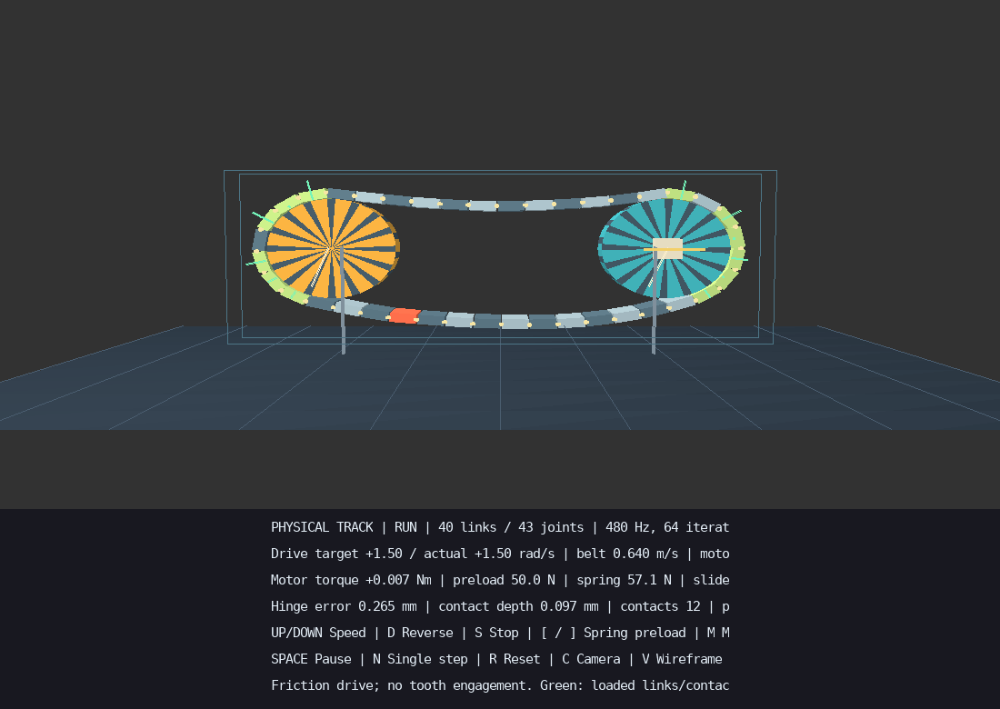](docs/screenshots/track_lab.png) | [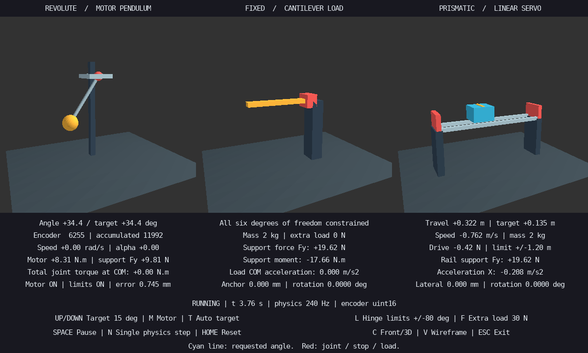](docs/screenshots/joint_lab.png) |
| **从轮带传动到整车装配。** 40 个履带刚体和闭环转动关节，主动轮摩擦驱动，从动轮滑架张紧；绿色标记受载链节。台架采用带侧向导向的共面近似。[进入 demo →](project_Demo/track_lab/README.md) | **转动、固定、滑动，三类关节同场。** 对照目标与实际角度、编码器回绕、反作用力矩和平台位移，可切换电机、限位与额外载荷。[进入 demo →](project_Demo/joint_lab/README.md) |

### 车辆与飞行

| 逐节刚体履带车 | 三车悬挂测试场 |
| :--- | :--- |
| [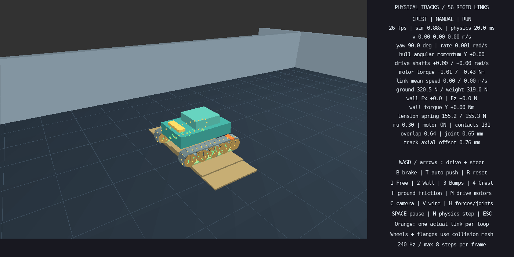](docs/screenshots/tracked_vehicle.png) | [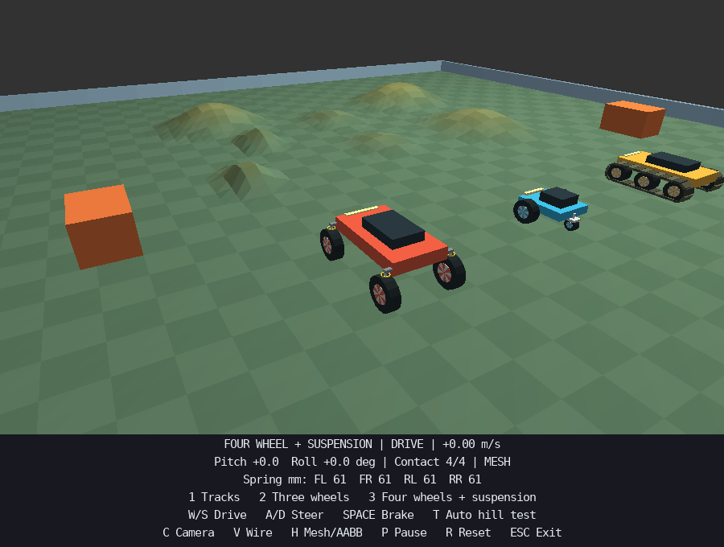](docs/screenshots/vehicle_playground.png) |
| **56 节履带，每节都是刚体。** 转动关节闭环，驱动轮通过摩擦带动履带；悬挂、张紧和地面反力参与求解。[进入 demo →](project_Demo/tracked_vehicle/README.md) | **三种底盘，同一片起伏地形。** 履带、两差速轮加万向轮、四轮独立悬挂；切车驾驶，查看接地数、姿态和各角压缩量。[进入 demo →](project_Demo/vehicle_playground/README.md) |

| 无人机与老鹰飞行场 | 猫头鹰键盘飞行 |
| :--- | :--- |
| [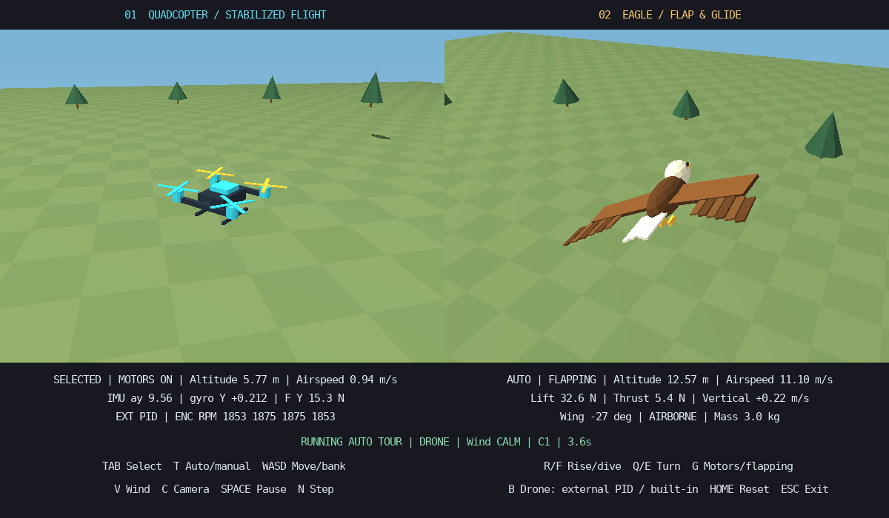](docs/screenshots/flight_playground.png) | [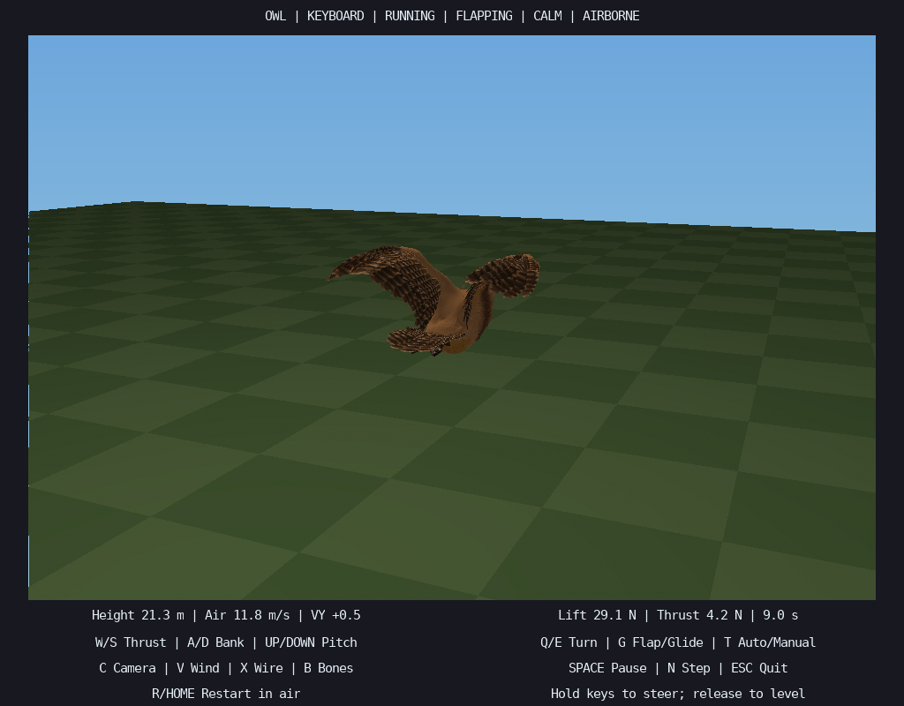](docs/screenshots/owl_flight.png) |
| **从电机指令到飞行反馈。** 无人机与老鹰自动或键盘飞行，支持阵风；无人机可切换独立 PID 控制，观察 IMU 与四电机转速。[进入 demo →](project_Demo/flight_playground/README.md) | **PME 飞行 + SKE 动画 + GRE 显示。** 键盘转弯、爬升、俯冲，切换拍翅与滑翔，实时查看飞行状态。[进入 demo →](project_Demo/owl_flight/README.md) |

### 抓取与感知

| 刚体夹爪抓取 | 软指夹持与形变 |
| :--- | :--- |
| [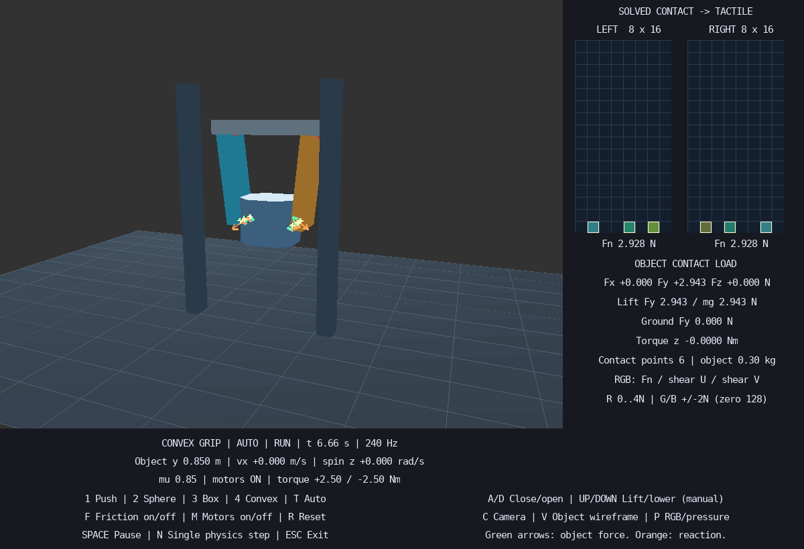](docs/screenshots/grasp_lab.png) | [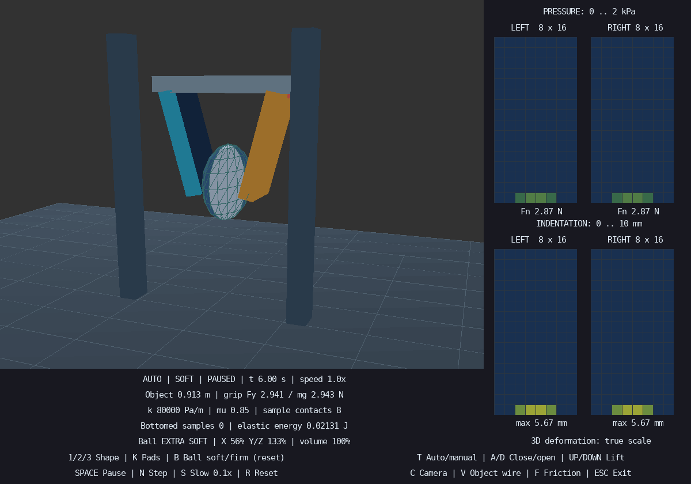](docs/screenshots/soft_finger.png) |
| **关节和接触在同一子步求解。** 抓取球、方块和削角凸体，观察摩擦承重与两指载荷；只有指腹带触觉，物体直接读取接触力和力矩。[进入 demo →](project_Demo/grasp_lab/README.md) | **夹住、抬升、松开、回弹。** 观察软垫压陷、软球整体形变与两指压力；只有指腹配置触觉。[进入 demo →](project_Demo/soft_finger/README.md) |

| 手掌把玩球 | 手掌皮肤按压 |
| :--- | :--- |
| [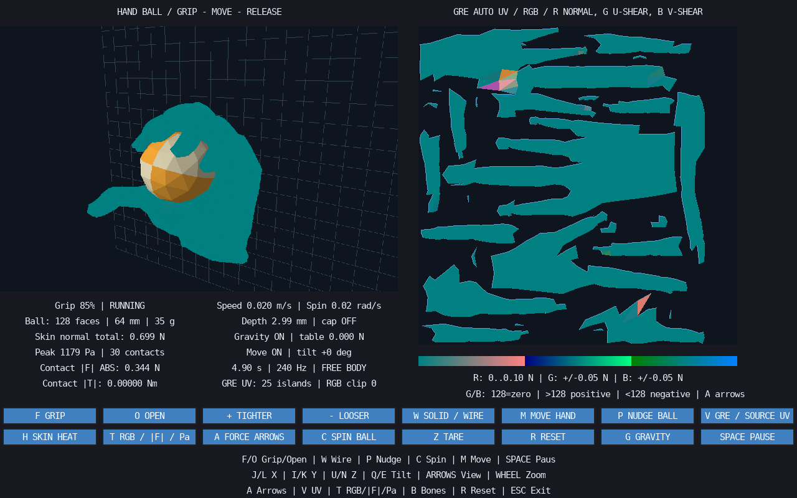](docs/screenshots/hand_ball.png) | [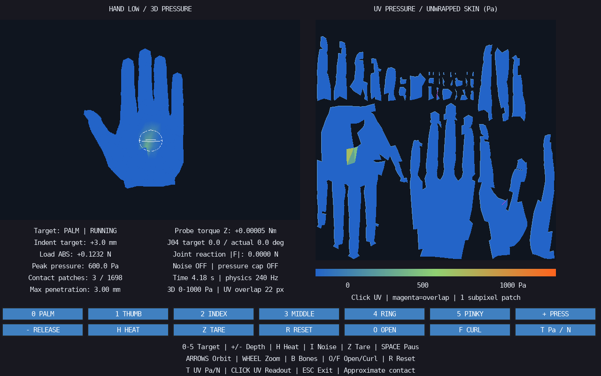](docs/screenshots/hand_skin.png) |
| **力也有方向。** 低模球抓握、移动和自旋；UV 上用 R/G/B 表示法向与两路切向力，也可看压力和方向箭头。[进入 demo →](project_Demo/hand_ball/README.md) | **从压入深度看压力分布。** 球形探头按压掌心或手指，观察曲面压力、反作用载荷及 UV 展开图；这是采样柔顺接触近似。[进入 demo →](project_Demo/hand_skin/README.md) |

| 人体自接触 | 全身触觉观测 |
| :--- | :--- |
| [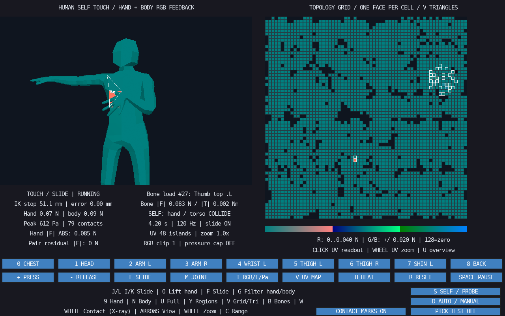](docs/screenshots/human_skin.png) | [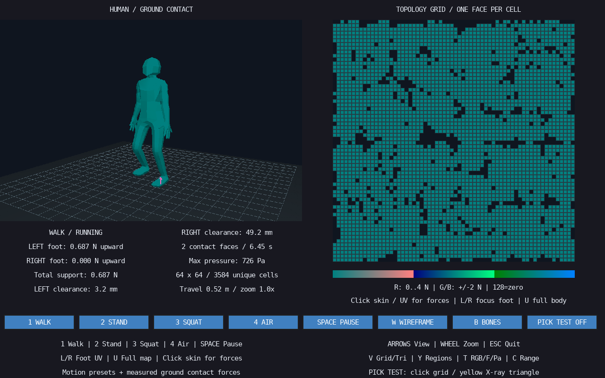](docs/screenshots/human_ground.png) |
| **手碰到身体，双方都能读取反馈。** 规定骨骼运动结合采样接触，支持按压、滑动和身体部位切换；三维面片与全身栅格可相互拾取。[进入 demo →](project_Demo/human_skin/README.md) | **3584 个面片，一张 64×64 小图。** 固定面片 ID、参考面积与浮点力可供智能体读取；脚底载荷来自规定动作下的接触计算。[进入 demo →](project_Demo/human_ground/README.md) |

**传感器实验台**

[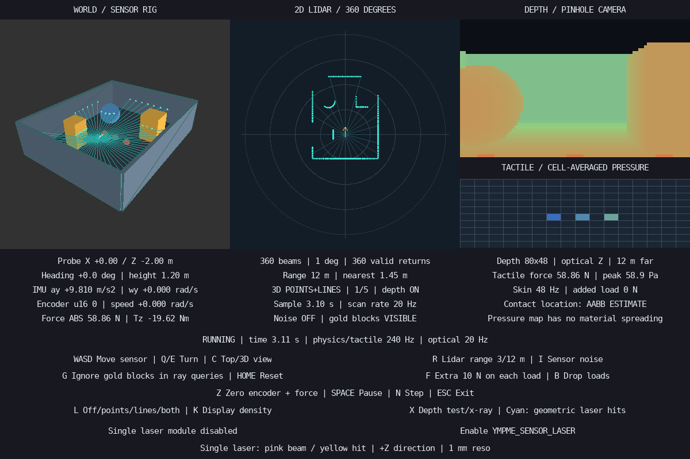](docs/screenshots/sensor_lab.png)

**同一个世界，多种观测。** 2D 360° 雷达、深度相机、触觉阵列，以及 IMU、编码器和六维测力读数。[进入 demo →](project_Demo/sensor_lab/README.md)

### 有限元静力分析

**从杆梁内力到三维实体应力。** 三个 C99 静力模块可分别开启，直接输入材料、网格、节点载荷与位移约束，输出位移、支座反力及单元结果；求解不依赖 GRE、DYNAMICS 或传感器，GRE 只负责交互显示。

**二维结构：7 个算例全部展示。** 在[二维窗口](Demo/statics_viewer/README.md)按 `1`～`7` 切换，`Tab` 选择节点查看位移、转角和反力。

| 1 · 悬臂梁 | 2 · 三角桁架 |
| :--- | :--- |
| [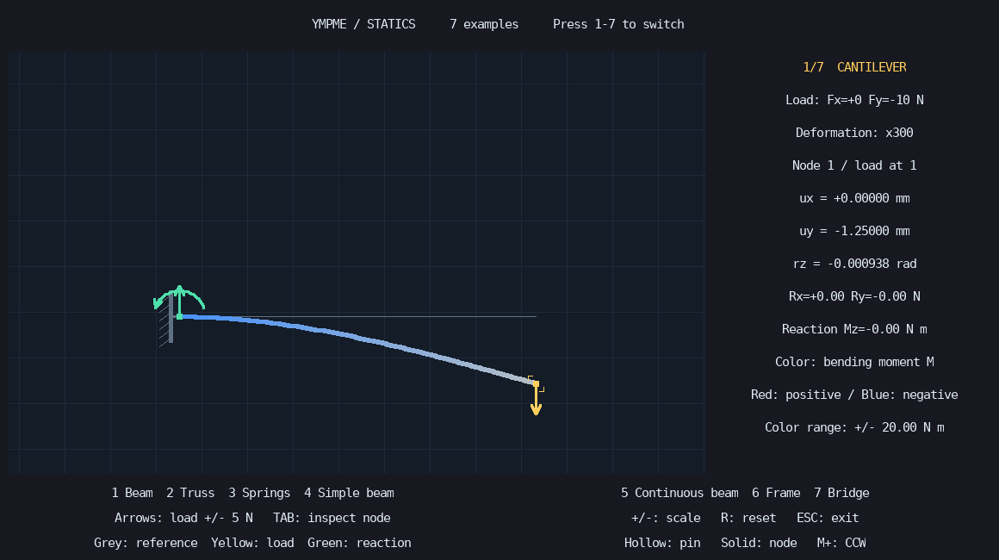](docs/screenshots/statics2d.png) | [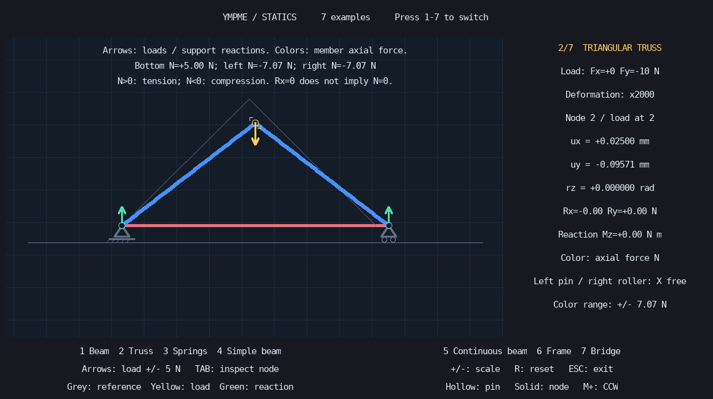](docs/screenshots/statics2d_truss.png) |
| 左端固支，2 m 梁端向下 10 N；颜色表示弯矩。 | 左铰右滚，顶部向下 10 N；底杆受拉、斜杆受压。 |

| 3 · 串联弹簧 | 4 · 简支梁 |
| :--- | :--- |
| [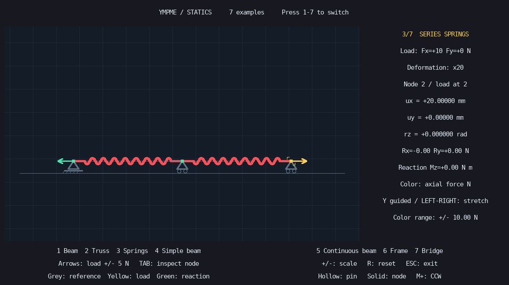](docs/screenshots/statics2d_springs.png) | [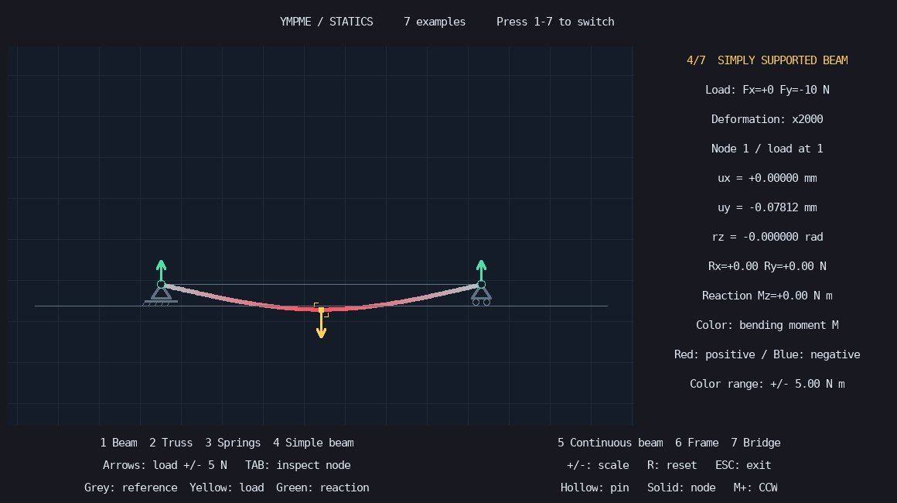](docs/screenshots/statics2d_simple_beam.png) |
| 两个 1000 N/m 轴向弹簧，右端拉力 10 N；节点约束 Y 向运动。 | 2 m 梁左铰右滚，跨中向下 10 N；观察挠度与两端支反力。 |

| 5 · 两跨连续梁 | 6 · 门式框架 |
| :--- | :--- |
| [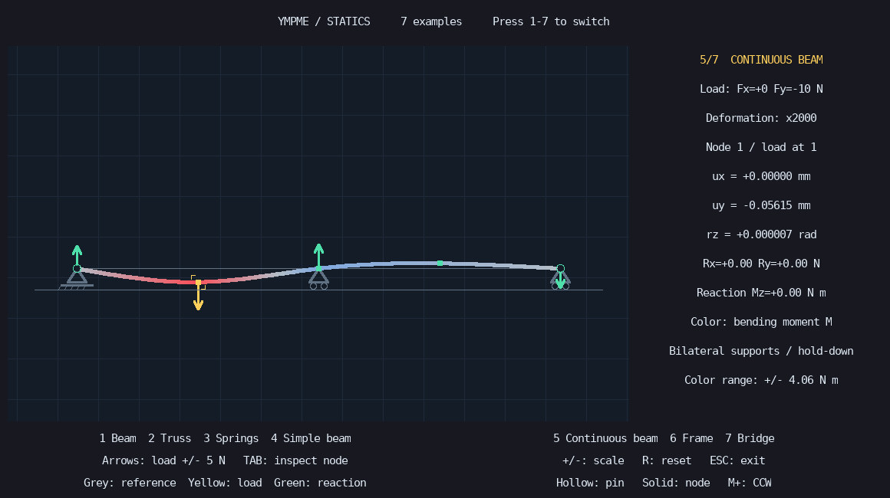](docs/screenshots/statics2d_continuous_beam.png) | [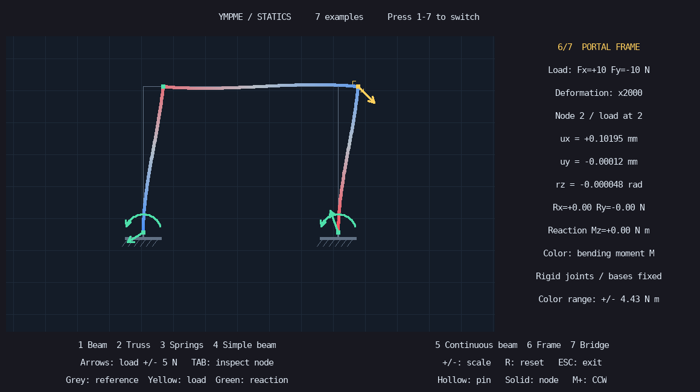](docs/screenshots/statics2d_frame.png) |
| 总长 4 m，左跨跨中向下 10 N；采用可承受抗拔反力的双向支承。 | 两柱脚固支，右上角 Fx=10 N、Fy=-10 N；查看刚接框架侧移与弯矩。 |

| 7 · Warren 桥式桁架 |
| :--- |
| [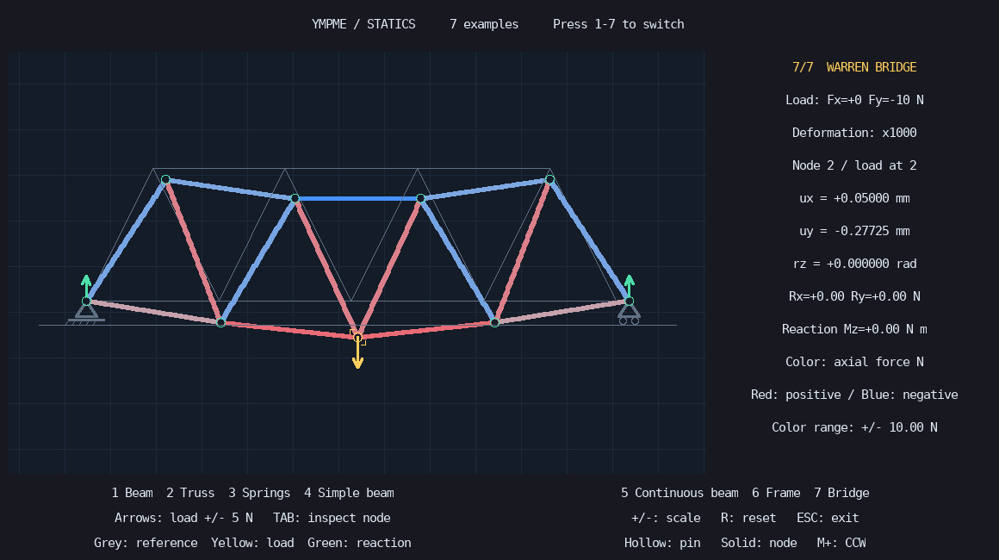](docs/screenshots/statics2d_bridge.png) |
| 9 节点、15 杆、跨度 4 m；中部下弦向下 10 N，红拉蓝压。 |

**三维杆梁：3 个算例全部展示。** 在[三维窗口](Demo/statics3d_viewer/README.md)按 `1`～`3` 切换；这是杆梁单元，每节点最多 6 自由度。

| 1 · 双向弯曲悬臂梁 | 2 · 空间四杆桁架 | 3 · 扭转悬臂梁 |
| :--- | :--- | :--- |
| [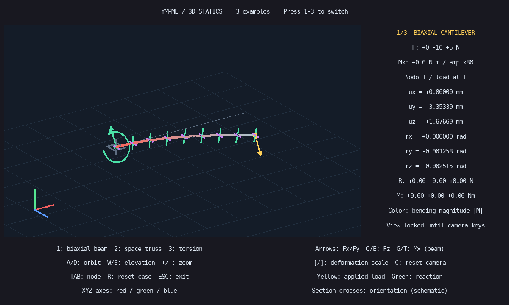](docs/screenshots/statics3d_bending.png) | [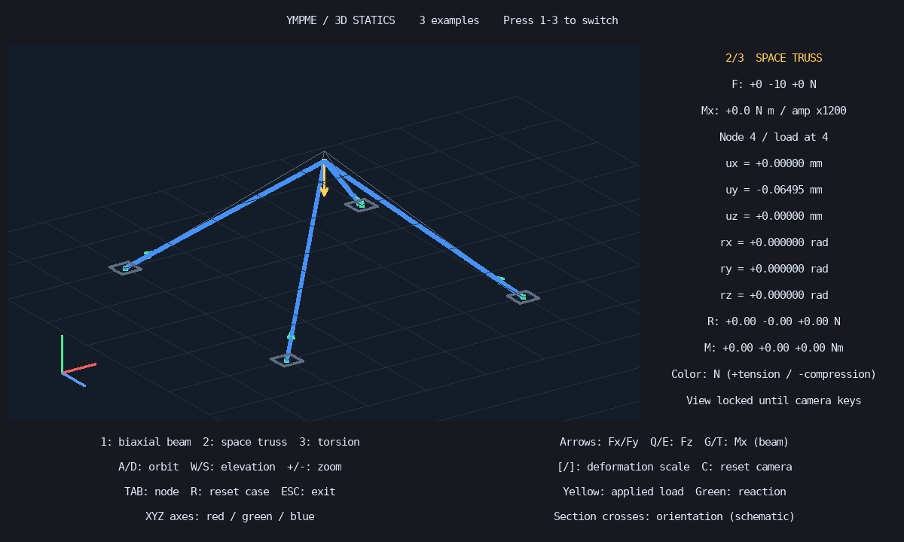](docs/screenshots/statics3d_truss.png) | [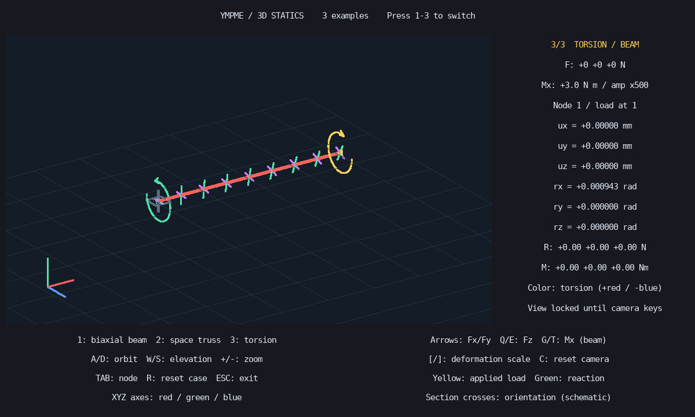](docs/screenshots/statics3d.png) |
| 根部六自由度固定，端部 Fy=-10 N、Fz=5 N；显示两个方向的弯曲。 | 四个底部节点固定平移，顶部向下 10 N；按杆件轴力着色。 | 端部 Mx=3 N·m；截面标记显示累积扭转，纯扭转时中心线保持笔直。 |

**三维实体：2 个算例各展示一次。** 在[实体窗口](Demo/solid_statics_viewer/README.md)按 `1` / `2` 切换；下图均为 von Mises 应力云图。

| 1 · 立方体压缩 | 2 · 块体弯曲 |
| :--- | :--- |
| [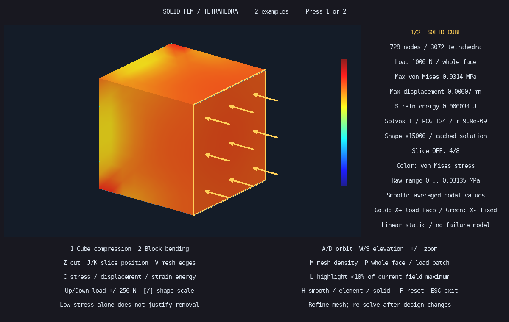](docs/screenshots/solid_statics_cube.png) | [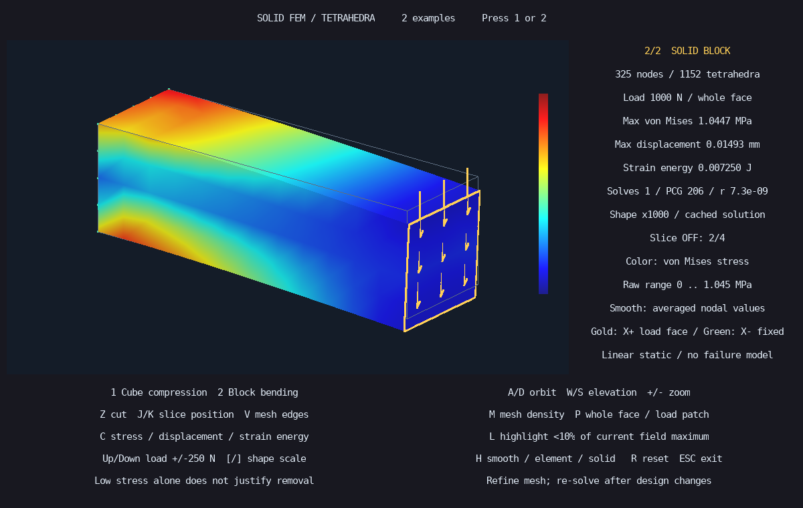](docs/screenshots/solid_statics.png) |
| 200×200×200 mm；729 节点、3072 个 TET4 单元。X− 面固定，X+ 面向 −X 均匀受力，总力 1000 N。 | 400×120×120 mm；325 节点、1152 个 TET4 单元。一端固定，另一端面沿 −Y 均匀受力，总力 1000 N。 |

实体窗口还支持 **Z 内部切片、H 平滑 / 原始单元 / 统一颜色、C 应力 / 位移 / 应变能密度、M 粗细网格**。切片只改变显示，平滑云图使用节点平均值，不提高求解精度；上面每个可切换算例只放一张图。

当前均为**小变形、线弹性静力分析**：改变载荷后重新求平衡，不包含振动、塑性、屈曲或接触非线性。显示倍率只放大画面，读数保持实际计算值；实体局部峰值需结合网格细化检查。这些模块与软指 demo 的 SOFTBODY 近似材料模型各自独立。

### 更多入门演示

<details>
<summary><b>展开三轮驾驶、CCD 薄墙对照与弹球截图</b></summary>

| 三轮差速小车 | 高速球与薄墙 |
| :--- | :--- |
| [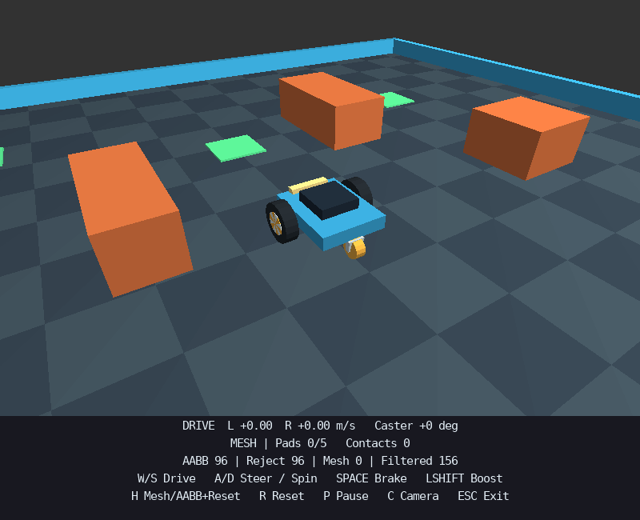](docs/screenshots/three_wheel_car.png) | [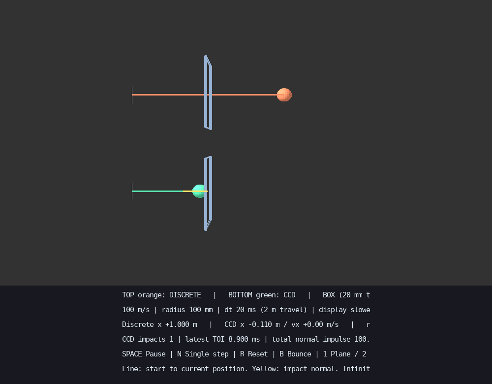](docs/screenshots/ccd_lab.png) |
| **两轮驱动，一个被动万向轮。** 键盘驾驶、原地转向、收集检查点，可切换 AABB 与凸 Mesh 精检测。[进入 demo →](project_Demo/three_wheel_car/README.md) | **同样的速度，不同的检测路径。** 100 m/s 的球对 20 mm 薄墙，慢放观察离散穿透与球体 CCD 响应。[进入 demo →](project_Demo/ccd_lab/README.md) |

**GRE 弹球入门**

[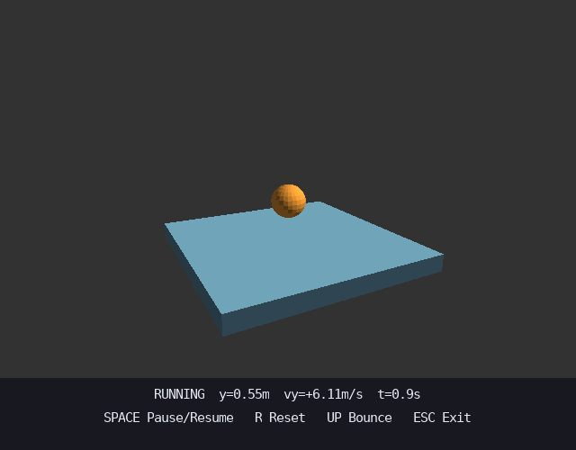](docs/screenshots/gre_bouncing_ball.png)

**最小物理与渲染闭环。** 重力、落地、反弹、暂停和再次施加速度，适合作为接入示例。[进入 demo →](project_Demo/gre_bouncing_ball/README.md)

</details>

## 能做什么

| 能力 | 当前实现 |
| :--- | :--- |
| 刚体与接触 | 可选三维惯量与四元数动力学；球、旋转盒、闭合凸 Mesh、静态平面；AABB 粗检测后精检测，接触摩擦与双方力 / 力矩反馈。 |
| 关节与机构 | 固定、转动、滑动关节，电机、限位、反作用力；DYNAMICS 在同一子步交替求解关节与接触，可选两类缓存和热启动。 |
| 按需碰撞 | 类别 / 掩码与分组过滤，装配内部可忽略；可选球体对静态环境 CCD。旧 World 与 DYNAMICS 的过滤接口有区别，见各模块文档。 |
| 复用模型 | 绳索、齿轮、皮带、滑轮、差速驱动、高度场、悬挂、车辆、单摆与飞行预设，按模块开启。 |
| 控制与观测 | 位置、姿态、速度、加速度、角速度和载荷真值；可选 IMU、uint16 单圈编码器、测力、激光、雷达、深度与触觉模块。 |
| 触觉与材料 | 曲面法向 / 切向力、参考面积上的平均压力、固定拓扑栅格；可选软垫和软球近似材料模型。普通物体无需创建 skin。 |
| 有限元静力 | 二维弹簧 / 桁架 / 梁框架、三维杆梁弯扭、TET4 实体；位移、反力、杆梁内力及实体应力 / 应变 / 应变能，三个模块独立裁剪。 |
| 可视化与动画 | GRE 负责窗口、输入和渲染；模型状态通过适配层同步。手、人体、猫头鹰 demo 在应用层接入 YMSKE。 |

默认使用**米、千克、秒**，Y 轴向上。物理固定步长与显示刷新分开；具体机构步长、迭代数及近似范围见对应 demo。

## 快速开始

从 YMPME 根目录执行。核心只需要 **C99 编译器与 CMake 3.16+**；GRE 窗口示例还需要本地 YMGRE 源码和它的桌面显示依赖（当前为 SDL2）。手、人体及猫头鹰示例另需 YMSKE 和对应资源，部分资源适配代码需要 C++ 编译器。

### 先运行纯物理

新构建目录采用默认选项时，不依赖 GRE、YMGUI、SDL 或 YMSKE：

```sh
cmake -S . -B build/core -DCMAKE_BUILD_TYPE=Release
cmake --build build/core -j
ctest --test-dir build/core --output-on-failure
./build/core/demo_free_fall
./build/core/project_Demo/bouncing_ball/demo_bouncing_ball
```

### 打开首页的齿轮窗口

下面假设 YMGRE 位于相邻的 `0502_YMGRE` 目录；按实际位置修改 `YMPME_GRE_ROOT`：

```sh
cmake -S . -B build \
  -DCMAKE_BUILD_TYPE=Release \
  -DYMPME_GRE_ROOT=../0502_YMGRE \
  -DYMPME_BUILD_GRE_DEMO=ON \
  -DYMPME_MODEL_GEAR=ON
cmake --build build --target demo_gear_mesh -j
./build/project_Demo/gear_mesh/demo_gear_mesh
```

**R 反转，T 自动往返，C 切视角，空格暂停，N 单步。** 紧耦合与带齿隙的两组通过逐齿接触传递力矩，可直接与理想约束比较。

这组命令构建齿轮示例。其他 demo 按各自文档启用所需模块；例如关节抓取需要 `YMPME_ENABLE_DYNAMICS=ON` 与 `YMPME_SENSOR_TACTILE=ON`，再构建 `demo_grasp_lab`。

### 打开有限元分析窗口

下面一次开启三个独立模块及其 GRE 窗口；只需要其中一种时，保留对应的一对 `ENABLE_*` / `BUILD_*_VIEWER` 开关即可：

```sh
cmake -S . -B build \
  -DYMPME_GRE_ROOT=../0502_YMGRE \
  -DYMPME_ENABLE_STATICS=ON -DYMPME_BUILD_STATICS_VIEWER=ON \
  -DYMPME_ENABLE_STATICS3D=ON -DYMPME_BUILD_STATICS3D_VIEWER=ON \
  -DYMPME_ENABLE_SOLID_STATICS=ON -DYMPME_BUILD_SOLID_STATICS_VIEWER=ON
cmake --build build --target demo_statics_viewer demo_statics3d_viewer demo_solid_statics_viewer -j
./build/Demo/statics_viewer/demo_statics_viewer
./build/Demo/statics3d_viewer/demo_statics3d_viewer
./build/Demo/solid_statics_viewer/demo_solid_statics_viewer
```

三个可执行文件都可直接双击，不依赖启动目录或外部模型资源。数字键切换算例；实体窗口按 **Z 切片、H 换着色方式、C 换物理量、M 换网格密度**。只调用求解库时无需启用窗口开关，也无需 GRE；链接目标和 API 见下方模块表。

### 直接找可执行文件

已有主工程构建的窗口 demo 通常位于 `build/project_Demo/<名称>/demo_<名称>`，可以直接双击。全部构建产物放在 `build/` 内；独立子工程的输出位置以对应说明为准。人体使用 `build/human` 的六槽蒙皮配置，猫头鹰使用 `build/owl_flight` 的四槽配置。

<details>
<summary><b>展开完整演示索引</b></summary>

| 名称 / 文档 | 看什么 |
| :--- | :--- |
| [gre_bouncing_ball](project_Demo/gre_bouncing_ball/README.md) | 最小 GRE 弹球窗口，暂停、重置与再次弹起。 |
| [three_wheel_car](project_Demo/three_wheel_car/README.md) | 两差速轮 + 后万向轮，驾驶与检查点。 |
| [vehicle_playground](project_Demo/vehicle_playground/README.md) | 三类车辆、独立悬挂、实际高度场小山包。 |
| [tracked_vehicle](project_Demo/tracked_vehicle/README.md) | 两条刚体闭环履带，坡面、顶墙、摩擦与悬挂。 |
| [track_lab](project_Demo/track_lab/README.md) | 单套轮带接触传动与张紧实验。 |
| [gear_mesh](project_Demo/gear_mesh/README.md) | 理想约束、紧耦合逐齿碰撞、齿隙回差。 |
| [mechanisms](project_Demo/mechanisms/README.md) | 约束 / 摩擦皮带、4:1 滑轮组、绳端挂物。 |
| [rope_lab](project_Demo/rope_lab/README.md) | 两端下垂、U 型绳端挂物、三维移动锚点。 |
| [joint_lab](project_Demo/joint_lab/README.md) | 电机单摆、固定悬臂、滑动平台和编码器。 |
| [grasp_lab](project_Demo/grasp_lab/README.md) | 关节手指抓取球、方块和削角凸体，摩擦开关对照。 |
| [soft_finger](project_Demo/soft_finger/README.md) | 软指压陷、软球形变、压力与释放回弹。 |
| [ccd_lab](project_Demo/ccd_lab/README.md) | 高速球穿越薄障碍的离散 / CCD 对照。 |
| [flight_playground](project_Demo/flight_playground/README.md) | 无人机、老鹰、阵风与传感器闭环控制。 |
| [owl_flight](project_Demo/owl_flight/README.md) | 带骨骼动画的猫头鹰，键盘飞行与滑翔。 |
| [sensor_lab](project_Demo/sensor_lab/README.md) | 雷达、深度、触觉、IMU、编码器与测力。 |
| [hand_skin](project_Demo/hand_skin/README.md) | 低模手皮肤按压、压力和剪切力。 |
| [hand_ball](project_Demo/hand_ball/README.md) | 手掌把玩球，UV 三维力图与方向箭头。 |
| [human_skin](project_Demo/human_skin/README.md) | 手摸身体、自体接触、全身触觉图与格子拾取。 |
| [human_ground](project_Demo/human_ground/README.md) | 规定动作下的脚底接触，固定全身观测导出。 |
| [statics_viewer](Demo/statics_viewer/README.md) | 二维弹簧、桁架、梁与框架，7 个静力算例。 |
| [statics3d_viewer](Demo/statics3d_viewer/README.md) | 空间桁架、梁双向弯曲与扭转。 |
| [solid_statics_viewer](Demo/solid_statics_viewer/README.md) | TET4 实体应力云图、内部切面、位移与应变能。 |

数值入门：`demo_free_fall` 与 [bouncing_ball](project_Demo/bouncing_ball/README.md)。每个 demo 的构建入口、按键及物理范围见上表链接。

</details>

## 模块与裁剪

**Demo 组织场景，MODEL 复用机构，核心计算物理；渲染和传感器按需要接入。** PME 物理库不包含 GRE、YMGUI、SDL 或 SKE 类型。GRE 的平台后端由 GRE 自己管理。

```text
YMPME/
├── CONFIG/          公共定义、功能开关、内存接口
├── CORE/            几何、碰撞、World、时间步；可选 RIGID / QUERY
├── JOINT/           通用关节、电机、限位与反馈
├── DYNAMICS/        刚体 / 关节 / 接触共同求解、缓存、可选 CCD
├── MODEL/           可复用机构、车辆、飞行与曲面观测模型
├── SENSOR/          可选传感器与采样接口
├── SOFTBODY/        可选软垫与软球材料近似
├── STATICS/         可选二维 / 三维杆梁与 TET4 实体静力分析
├── EXT/FLIGHT/      旋翼与气动力载荷
├── OPOBJ/           物体描述、初始化及生命周期
├── BRIDGE/          可选渲染适配
└── YMPME.h          聚合头文件
Demo/                单模块示例（可含窗口与交互）
project_Demo/        多模块组合的完整应用场景
Resource/            示例资源
extern_lib/          外部依赖约定
sdk/                 SDK 打包、消费示例与手册
tests/              无窗口与窗口回归测试
```

核心默认保持精简，扩展通过 CMake 显式开启：

| 需要的能力 | 主要开关 | 文档 |
| :--- | :--- | :--- |
| 旋转刚体 / 关节 / 共同求解 | `YMPME_ENABLE_RIGID` / `YMPME_ENABLE_JOINT` / `YMPME_ENABLE_DYNAMICS` | [RIGID](YMPME/CORE/RIGID/README.md) · [JOINT](YMPME/JOINT/README.md) · [DYNAMICS](YMPME/DYNAMICS/README.md) |
| 机构与车辆 | `YMPME_MODEL_<名称>`，如 `ROPE`、`GEAR`、`VEHICLE` | [模型与依赖](YMPME/MODEL/README.md) |
| 飞行载荷与预设 | `YMPME_ENABLE_FLIGHT`、`YMPME_MODEL_AIRCRAFT`；旋翼 / 气动可再细分 | [FLIGHT](YMPME/EXT/FLIGHT/README.md) · [AIRCRAFT](YMPME/MODEL/AIRCRAFT/README.md) |
| 几何查询与传感器 | `YMPME_ENABLE_QUERY`、`YMPME_SENSOR_<名称>` | [QUERY](YMPME/CORE/QUERY/README.md) · [SENSOR](YMPME/SENSOR/README.md) |
| 曲面触觉与栅格 | `YMPME_MODEL_SKIN`、`YMPME_MODEL_SURFACE_ATLAS`、`YMPME_SENSOR_TACTILE` | [SKIN](YMPME/MODEL/SKIN/README.md) · [拓扑网格](YMPME/MODEL/SURFACE_ATLAS/TOPOLOGY_GRID.md) |
| 近似柔性材料 | `YMPME_ENABLE_SOFTBODY` | [SOFTBODY](YMPME/SOFTBODY/README.md) |
| 二维结构静力 | `YMPME_ENABLE_STATICS`；链接 `YMPME::statics` | [STATICS](YMPME/STATICS/README.md) |
| 三维杆梁静力 | `YMPME_ENABLE_STATICS3D`；链接 `YMPME::statics3d` | [STATICS3D](YMPME/STATICS/README3D.md) |
| 三维实体静力 | `YMPME_ENABLE_SOLID_STATICS`；链接 `YMPME::solid_statics` | [SolidStatics](YMPME/STATICS/README-solid.md) |
| GRE 显示 / 适配 | `YMPME_BUILD_GRE_DEMO` / `YMPME_BUILD_GRE_BRIDGE` | [最小窗口](project_Demo/gre_bouncing_ball/README.md) |

各模块声明必要依赖，不必为了使用物理而开启所有传感器。模型优先使用调用方缓冲，初始化建立绑定，步进与显示复用状态和网格；正常帧避免反复分配。涉及布局转换的适配仍有必要的读写成本，详见 [模型对接约定](YMPME/MODEL/README.md#高效对接约定)。

## 使用 SDK

运行 `python3 sdk/build.py` 生成 `build/YMPME_libs`，包含 16/32 位两份全功能一体库，默认选择 16 位以配套 GRE。使用 `YMPME::ympme` 和 `PME_Index`；设置 `YMPME_INDEX_BITS=32` 切换位宽。原分模块脚本保留为 `sdk/build_modular.py`。

[共享网格说明](SHARED_MESH.md)介绍了如何直接借用 GRE 持有的局部几何、独立使用渲染工作缓存以及安全解绑。物理库不依赖 GRE；原生适配源码随 SDK 示例提供。

详见 [SDK 说明](sdk/README-unified.md)。升级至 0.3.x 后，旧消费者应使用新的头文件和库一起重新编译。

## 适用范围

项目适合小规模交互场景、机构原型、控制和感知接口实验。使用时按具体求解路径判断能力：

- **旧 World 与 DYNAMICS 分工不同。** 旧 World 以平移刚体为主；通用旋转、关节和接触耦合使用 DYNAMICS。不要对同一批物体重复积分。旧车辆、飞行与皮肤 demo 尚未全部迁移到共同求解器。
- **精检测当前面向闭合凸网格。** 不提供自动凸包或通用凹网格求解；高度场由车辆模型单独采样。配对仍以小规模场景为目标，尚无通用岛划分、休眠与窄相位空间树。
- **CCD 有明确范围。** 当前支持满足配置条件的动态球对静态环境，动态体之间、旋转非球体和关节机构仍采用离散接触，不能据此保证高速齿轮或履带不穿透。
- **反馈与材料有近似。** 冲量 / dt 是子步平均载荷，含稳定化修正；面片力 / 参考面积是整片平均压力。软垫与软球不是通用 FEM，人体步态是规定骨骼运动下的接触观测，猫头鹰采用等效鸟类翼面预设。
- **有限元目前限于线弹性静力。** STATICS 的杆梁与实体求解独立于运动仿真，不自动接入刚体碰撞；不包含大变形、塑性、屈曲、断裂或瞬态动力学。
- **部署前测量目标工况。** MCU 性能需要在实际硬件上验证；较长机构、高速度和高刚度需实测步长与迭代数，浮点结果不保证跨平台逐位一致。

接口和所有权见 [API](API.md)；结构与路线见 [ARCHITECTURE](ARCHITECTURE.md)、[PROJECT](PROJECT.md)；Mesh 精检测、开关和过滤见 [MESH_COLLISION](MESH_COLLISION.md)。

## 授权声明

个人及非商业组织以非营利目的学习、研究或自用 YMPME，可免费使用；商业用途必须事先说明并取得著作权人的书面授权。对外分发修改版或使用修改版对外提供服务时，须按许可条款公开本库的对应源码及必要构建文件。第三方资源及外部依赖按各自原许可使用。完整条款见 [LICENSE](LICENSE)。
